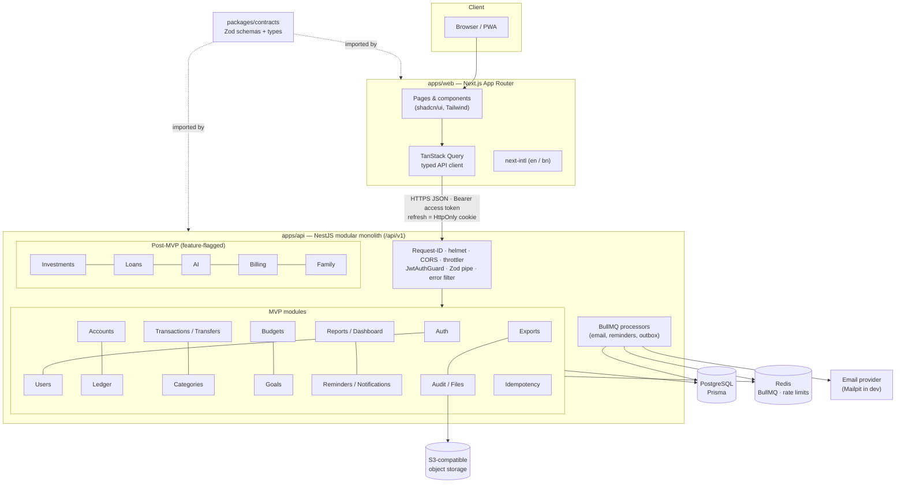
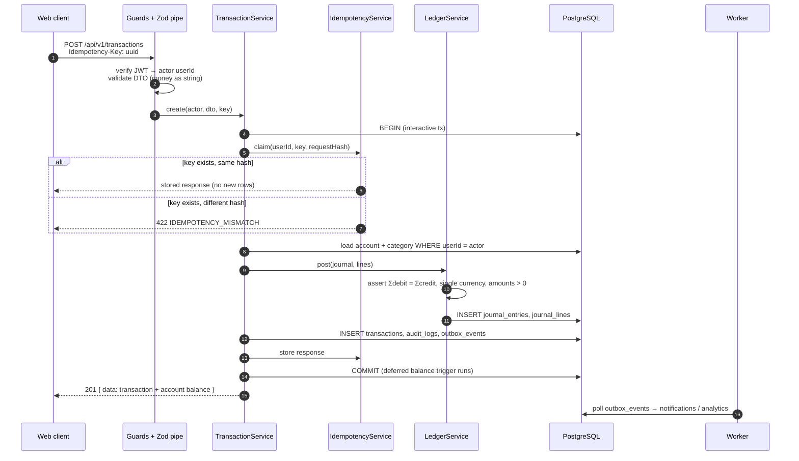
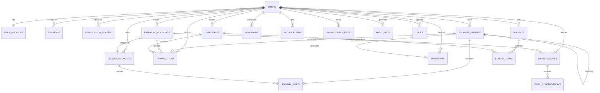

# TakaWise — Architecture & Decision Records

> Phase 0 · 2026-11-05 · Status legend: **Accepted** (default adopted) · **Proposed** (needs owner confirmation)
> See [../implementation-plan.md](../implementation-plan.md) for the phase plan.

---

## Architecture overview

### Posting sequence (income / expense / transfer)

### Core ERD (MVP)

---

## ADR index

| #   | Title                                                                                  | Status   |
| --- | -------------------------------------------------------------------------------------- | -------- |
| 001 | Monorepo with pnpm workspaces, modular monolith                                        | Accepted |
| 002 | Shared Zod contracts package                                                           | Accepted |
| 003 | Money representation: NUMERIC(20,4), Decimal, strings on the wire                      | Accepted |
| 004 | Double-entry ledger is the source of truth; balances are derived                       | Accepted |
| 005 | Balanced-journal invariant enforced in service + deferred DB trigger                   | Accepted |
| 006 | Idempotency via a dedicated table, inside the posting transaction                      | Accepted |
| 007 | Chart of accounts: one ledger account per financial account + per-user system accounts | Accepted |
| 008 | Credit card tracked as a liability                                                     | Accepted |
| 009 | Savings goals use the earmark model                                                    | Accepted |
| 010 | Corrections by reversal; reversal dated to the original effective date                 | Accepted |
| 011 | Auth: short-lived JWT access token + rotating opaque refresh cookie                    | Accepted |
| 012 | Time: UTC timestamps, separate local `effectiveDate`, default Asia/Dhaka               | Accepted |
| 013 | Ownership: actor from session, scoped queries, 404 on foreign resources                | Accepted |
| 014 | Background work: BullMQ inside the API process + transactional outbox                  | Accepted |
| 015 | Testing against real PostgreSQL; Jest (api), Vitest (web), Playwright (e2e)            | Accepted |
| 016 | Single currency per transaction; same-currency transfers only; no FX in MVP            | Accepted |
| 017 | Dev email via Mailpit; console OTP impossible in production                            | Accepted |
| 018 | Toolchain versions: NestJS 11, TypeScript 6, ESLint 9, SWC compilation                 | Accepted |
| 019 | Prisma 7 with pg driver adapter; DB-level invariants and composite ownership FKs       | Accepted |
| 020 | UI localisation (typed dictionary), money/date formatting, accessible charts           | Accepted |
| 021 | Release hardening & operations (rate limits, metrics, redaction, images, CI/CD)        | Accepted |
| 022 | Investments and loans are ledger accounts with detail records                          | Accepted |
| 023 | Valuations and net worth: labelled user values, computed on read, no double counting   | Accepted |
| 024 | Opt-in AI and OCR: backend facts, fact-reference prose, consent, no auto-save          | Accepted |
| 025 | Plans, entitlements and billing: server-enforced, signed idempotent webhooks           | Accepted |
| 026 | Family workspaces: invitation codes, explicit read-only shares, immediate revocation   | Accepted |
| 027 | Staff roles, admin route group and support: no access to financial content             | Accepted |

---

### ADR-001 — Monorepo with pnpm workspaces, modular monolith

**Context:** One small team ships web and API together and shares types between them.
**Decision:** pnpm workspaces (`apps/*`, `packages/*`), with no Turborepo at first. NestJS modules have explicit boundaries: a module exposes a service and never reaches into another module's Prisma models. Ledger writes go only through `LedgerService`.
**Consequences:** Simple tooling. The worker can be split out later without a rewrite. Turbo can be added if CI gets slow.

### ADR-002 — Shared Zod contracts package

**Decision:** `packages/contracts` holds Zod schemas for request DTOs and response shapes, and both apps import them. The API validates with a Zod pipe and generates Swagger from the schemas. Prisma types never leave `apps/api`; responses are mapped explicitly.
**Consequences:** One schema serves form validation and server validation. The browser never sees DB entities (blueprint Phase 2 rule).

### ADR-003 — Money representation

**Decision:** PostgreSQL `NUMERIC(20,4)`, Prisma `Decimal`, and `decimal.js` in domain code. In JSON, money is a **string** (`"450.00"`). Amounts are always positive; direction comes from transaction type and debit/credit. Rounding is half-even to 2 dp **for display only**, and stored values keep 4 dp. ESLint `no-restricted-syntax` bans `parseFloat` and `Number()` on money fields in API domain folders.
**Consequences:** No floating-point drift. The client formats strings with `Intl.NumberFormat` without doing arithmetic on them.

### ADR-004 — Ledger is the source of truth

**Decision:** Account balances, income/expense totals, budgets and reports are all derived from posted `journal_lines` (joined with `transactions` for categories). There is no stored balance column in the MVP. If profiling later shows a need, a projection table may be added, but it must be rebuildable from the ledger, and a `reconcile` command will verify it.
**Normal-balance rules (central, unit-tested):**

| Class     | Normal | Balance formula  |
| --------- | ------ | ---------------- |
| ASSET     | DEBIT  | Σdebit − Σcredit |
| EXPENSE   | DEBIT  | Σdebit − Σcredit |
| LIABILITY | CREDIT | Σcredit − Σdebit |
| EQUITY    | CREDIT | Σcredit − Σdebit |
| INCOME    | CREDIT | Σcredit − Σdebit |

### ADR-005 — Balanced-journal invariant

**Decision:** `LedgerService.post()` asserts ≥ 2 lines, a single currency, each line with exactly one positive side, and Σdebit = Σcredit before inserting. In addition, a raw-SQL migration adds:

- a CHECK on `journal_lines`: `(debit > 0 AND credit = 0) OR (credit > 0 AND debit = 0)`;
- a `CONSTRAINT TRIGGER ... DEFERRABLE INITIALLY DEFERRED` on `journal_lines` that, at commit, raises if any affected journal is unbalanced.

Posted journals and lines are immutable: application code never updates or deletes them, and a trigger blocks UPDATE/DELETE on `journal_lines`.
**Consequences:** A bug in any code path cannot commit an unbalanced or edited history.

### ADR-006 — Idempotency

**Decision:** The `Idempotency-Key` header (UUID) is **required** on `POST /accounts`, `/transactions`, `/transfers`, `/transactions/:id/reverse` and `/goals/:id/contributions`. The `idempotency_keys` row (PK `userId, key`) is inserted **inside the same DB transaction** as the posting, along with a SHA-256 hash of the canonical request. On a replay with the same hash, the stored response is returned. With a different hash, the API returns 422. Concurrent duplicates hit the PK and the loser retries the read. Keys expire after 24 h (a cleanup job removes them).
**Consequences:** Retries after network failures or double-clicks are safe.
**Implementation (Phase 4):** `IdempotencyService.execute()` runs the command inside the same `$transaction` that inserts the key. The request hash is SHA-256 of `scope + canonical JSON`. A replay sets the `Idempotent-Replayed: true` header, and a lost race on the primary key rolls back and returns the winner's stored response. Expired keys (> 24 h) are deleted lazily when the same key is reused. A scheduled cleanup job arrives with BullMQ in Phase 5.

### ADR-007 — Chart of accounts

**Decision:** Every financial account gets exactly one ledger account (1:1). Each user gets system ledger accounts `EQUITY_OPENING_BALANCE`, `INCOME` and `EXPENSE`, created from seeded `ledger_account_templates` at registration. Categories are a dimension on `transactions`, **not** separate ledger accounts.
**Alternatives considered:** a ledger account per category. It gives a richer chart of accounts but makes category edits and archiving complex, and adds nothing for MVP reporting.
**Consequences:** Category breakdown is computed from posted `transactions` that are not reversed. The ledger stays small and simple.

### ADR-008 — Credit card as a liability _(Accepted 2026-11-05)_

**Decision:** `CREDIT_CARD_TRACKING` accounts map to a LIABILITY ledger account (credit-normal). Opening balance is the amount owed (Dr Equity:Opening / Cr Liability). An expense on the card is Dr Expense / Cr Liability. A bill payment is a **transfer** Bank → Card (Dr Liability / Cr Bank), so it is not counted as an expense, which avoids double counting. The UI labels the balance as "Owed". Dashboard "Net balance" = Σ assets − Σ liabilities per currency. Credit limit is optional metadata in the MVP, with no interest or statement logic.
**Confirmed:** credit cards stay in the MVP.

### ADR-009 — Savings goals: earmark model _(Accepted 2026-11-05)_

**Options:** (a) **earmark** against an existing account; (b) actual transfer into a dedicated savings account.
**Decision:** (a) earmark. A goal links to one active asset account in the same currency. `goal_contributions` is append-only, with no ledger journal. Each row has a positive `amount` and a `kind`: `CONTRIBUTION` (set money aside), `WITHDRAWAL` (release money) or `REVERSAL` (corrects one earlier row, with the same amount and once only). Progress = Σ CONTRIBUTION − Σ WITHDRAWAL over rows that are `POSTED` and not reversed. _(Refined in Phase 2: the original wording "a withdrawal is a reversal row" conflated two different user intents.)_ A contribution is rejected if Σ earmarks across that account's goals would exceed its current ledger balance. If the balance later falls below the earmarks, the UI warns ("under-funded"), and no automatic changes are made. Goal amounts cannot be edited directly.
**Why:** No artificial money movement, no extra account the user doesn't actually have, and it fits the common Bangladesh pattern of "this bank balance is for X". Users who actually keep a separate savings account can link the goal to that account, which gives the same result as (b).
**UI copy (required):** "Goal savings are set aside from {account}. No money is moved."
**Implementation (Phase 5):**

- The cap is checked under a row lock on the linked account.
- Archiving a goal releases its earmark.
- Reversing an entry is always allowed, even if it leaves the account under-funded. The goal then shows `underFunded`.
- Reaching the target creates a `GOAL_ACHIEVED` notification.
- See [docs/api/planning.md](../api/planning.md).

### ADR-010 — Corrections by reversal _(Accepted 2026-11-05)_

**Decision:** Posted transactions and transfers are never edited or deleted. `POST /transactions/:id/reverse` creates a REVERSAL journal with every line swapped, `reversesId` set to the original, and **the same effectiveDate as the original**. The original is marked `REVERSED`, and both remain visible in history. A journal can be reversed only once, and reversal journals cannot themselves be reversed (409). The UI's "Edit" action means reverse and create a replacement, done in one idempotent request (`/transactions/:id/replace`, Phase 4 stretch).
**Non-financial notes:** the free-text `description` of a posted transaction or transfer may be edited, because it changes no amounts, accounts or dates. The database allows only that field and the `POSTED → REVERSED` transition (see [erd.md](erd.md)).
**Why the same date:** For personal finance, the user is fixing a mistake, so the original month's report should change. Budgets and reports exclude both the reversed original and its reversal.
**Alternative:** date the reversal "today" (traditional accounting). Rejected for the MVP because it distorts past-month reports.

### ADR-011 — Authentication & sessions

**Decision:**

- Passwords use Argon2id (`@node-rs/argon2`, OWASP parameters: m=19 MiB, t=2, p=1). Minimum 8 characters, checked against a common-password list.
- The **access token** is a JWT (HS256, 15-minute lifetime, claims `sub`, `sid`). The web client keeps it in memory and sends it as `Authorization: Bearer`.
- The **refresh token** is 256-bit opaque random, stored as a SHA-256 hash in `sessions`, with a 30-day lifetime. It is sent as a cookie `tw_rt` with HttpOnly, Secure (non-dev), `SameSite=Strict` and `Path=/api/v1/auth`. It **rotates on every refresh**. Reusing an already-rotated token revokes the whole `familyId`.
- **CSRF:** Bearer-protected routes are not CSRF-exposed. The cookie routes (`/auth/refresh` and `/auth/logout`) require an `Origin` header in the allowlist **and** an `X-CSRF-Token` matching a non-HttpOnly `tw_csrf` cookie (double-submit).
- Web and API are served **same-site** (e.g. `app.` and `api.` under one domain; `localhost:3100` and `localhost:4000` in dev). CORS uses an explicit allowlist with `credentials: true`.
- Authenticated `/app/*` pages are client-rendered and perform a silent refresh on load, and the marketing pages are static. Edge middleware only redirects when the `tw_csrf` hint cookie is absent, as a UX shortcut that does not provide security.
- A password reset or "log out everywhere" revokes all sessions.

**Implementation notes (Phase 3, 2026-11-05):**

- Every authenticated request also checks that the session row is live and the user is ACTIVE, so revocation takes effect immediately. This costs one indexed primary-key lookup per request.
- Refresh tokens are opaque and stored as SHA-256. `JWT_REFRESH_SECRET` is therefore unused. `AUTH_HMAC_SECRET` (which must differ from `JWT_ACCESS_SECRET`) keys OTP and IP hashes.
- Reuse detection is strict: any second use of a rotated token, including a concurrent double refresh, revokes the family. The web client refreshes single-flight.
- Verification attempts are committed outside the caller's transaction, so a rollback cannot erase a failed guess.
- `verify-email` signs the user in. Registration, resend and forgot-password give identical responses whether or not the account exists.
- Rate limits are in memory, one instance only. Redis storage is planned for Phase 7.
- `@nestjs/jwt` is pinned to 11.x, because 12.x is ESM-only (ADR-018).
- Full reference: [docs/api/auth.md](../api/auth.md).

### ADR-012 — Time handling

**Decision:** All timestamps are `timestamptz` in UTC. Transactions carry `occurredAt` (instant) **and** `effectiveDate` (date), which the server derives using the user's profile timezone (default `Asia/Dhaka`, UTC+6, no DST). Budgets, reports and filters operate on `effectiveDate`. Reminders store `dueAt` in UTC, and the UI converts from and to the user's timezone.

### ADR-013 — Authorization & ownership

**Decision:** The actor always comes from the verified JWT (`@CurrentUser()`), and any `userId` in a body or query is rejected by the schemas. Every repository method on owned tables takes `userId` and includes it in the `WHERE` clause. A resource owned by someone else returns **404** (`NOT_FOUND`). A shared cross-user test suite seeds users A and B and calls every route with A's token against B's IDs. Default deny: every controller is protected unless decorated `@Public()`.

### ADR-014 — Background jobs & outbox

**Implementation (Phase 5):**

- The `bullmq` package is used directly; `@nestjs/bullmq` is not, because its 12.x is ESM-only (ADR-018).
- There is one `maintenance` queue with job schedulers: `reminders.dispatch` (60 s) and `idempotency.cleanup` (1 h). Handlers are database sweeps that are safe to run concurrently (`FOR UPDATE SKIP LOCKED`). There are no per-entity delayed jobs, so edits and cancellations never leave stale jobs behind.
- Startup never blocks on Redis. Readiness reports a Redis outage as `degraded`.
- The outbox _publisher_ is deferred until the first consumer exists (budget alerts, v1.1).

**Decision:** BullMQ queues (`email`, `reminders`, `outbox`, `maintenance`) run inside the API process for the MVP, behind a `WORKER_ENABLED` flag so a separate worker deployment is possible later. Financial commands write `outbox_events` in the same DB transaction, and a poller publishes them to queues. As a result, notifications never fire for rolled-back postings. Redis is never authoritative.

### ADR-015 — Testing strategy

**Decision:** Integration tests run against a real PostgreSQL (`takawise_test`, from Compose locally and a fresh service container in CI). Before the DB suite, Jest global setup runs `prisma migrate deploy` and the idempotent seed. **Nothing is reset or truncated.** Every test creates its own users (random emails), so files run in parallel and never see each other's data. A guard refuses any test database whose name does not end in `_test`. _(Refined in Phase 2: truncating was dropped. Isolated fixtures are safer, and Prisma 7 also blocks agent-run `migrate reset` without explicit human consent.)_ Ledger rules use unit tests plus randomized balanced/unbalanced journal generation. The API uses Jest + Supertest, web and contracts use Vitest, and E2E uses Playwright at desktop and mobile viewports. Coverage gates apply to the `ledger`, `transactions`, `budgets` and `auth` modules.

### ADR-016 — Currency

**Decision:** Every account, journal and transaction stores an ISO-4217 code. The MVP UI offers BDT by default and allows other codes for accounts. Transfers and goal links require matching currencies. Totals are grouped **per currency** and are never summed across currencies. FX is deferred.

### ADR-017 — Development email & OTP safety

**Decision:** Docker Compose runs **Mailpit** (SMTP on host :1035, UI on http://localhost:8035), and dev sends real emails to it. A `DEV_LOG_OTP=true` option prints OTPs to the console. At boot, the env schema **fails** if `DEV_LOG_OTP` is true while `NODE_ENV` is not `development`, and the code path is also guarded at runtime. Production uses an email-provider adapter (provider TBD).

---

## Out of scope for MVP (recorded)

- Bank, bKash, Nagad, Rocket or card integrations, scraping, and collection of credentials, PINs, OTPs or CVVs.
- Payment initiation, custody, lending, investment execution.
- AI advice, OCR and recurring transactions (v1.1+), family workspaces, billing, admin console.
- Native mobile apps (the web app is responsive and PWA-ready).

### ADR-018 — Toolchain versions (Phase 1, 2026-11-05)

**Context:** At Phase 1 time the latest majors were NestJS 12 (ESM-only, released 2026-08), TypeScript 7 (native compiler) and ESLint 10.
**Decision:**

- **NestJS 11.2.x (CommonJS)**, not 12. Nest 12 is ESM-only and recent, and `nestjs-zod` supports only Nest ≤ 11. CommonJS keeps Jest, Prisma and the tooling simple. Revisit after the MVP.
- **TypeScript ~6.0**, not 7. `typescript-eslint` (< 6.1), `ts-jest` and `@nestjs/swagger` do not support TS 7 yet.
- **ESLint 9.39**, not 10. `eslint-plugin-react`, `-import` and `-jsx-a11y` (used by `eslint-config-next`) do not support ESLint 10 yet.
- **SWC compiles the API** in dev (`nest start --watch`), build (`nest build`) and tests (`@swc/jest`). TypeScript 6 is used only for `typecheck`. This avoids Nest CLI's bundled TS 5.9 and ts-jest's limits with `nodenext`.
- The API is tested with **Jest + Supertest**. Web and contracts are tested with **Vitest**.
- pnpm 10 dependency build scripts are allow-listed (`@swc/core`, `@parcel/watcher`), and analytics postinstalls (`@scarf/scarf`) are denied.

**Consequences:** All pins are exact in the package manifests and the lockfile. Upgrading any of the three majors is a deliberate, separately tested change.

### ADR-019 — Prisma 7 and database-level invariants (Phase 2, 2026-11-05)

**Context:** npm's `latest` tag for `prisma` pointed at a release candidate (8.0.0-rc) at Phase 2 time. Prisma 7 is ESM-first, needs a driver adapter, and moves connection URLs out of `schema.prisma`.
**Decision:**

- **Prisma 7.10.1** (the last stable release), pinned exactly, with `@prisma/adapter-pg`. The `prisma-client` generator emits a **CommonJS** client into `apps/api/src/generated/prisma`. The client is git-ignored and regenerated by the API's `postinstall`.
- The connection URL lives in `apps/api/prisma.config.ts` (which loads `apps/api/.env` locally). The API builds clients through `createPrismaClient()` and `PrismaService`, which connect lazily so `/health` stays up while `/health/ready` reports the database as down.
- **Defence in depth:** every financial rule is enforced in SQL as well as in services. This covers CHECKs, a deferred balanced-journal constraint trigger, immutability triggers, category and currency consistency triggers, and partial unique indexes. Ownership is also enforced in SQL through **composite foreign keys** `(child.x_id, child.user_id) → parent(id, user_id)`. A bug that forgets a `userId` filter therefore cannot link two users' records. See [erd.md](erd.md) for the full catalogue.
- Prisma does not model these SQL objects, so they live in a hand-written migration. CI proves there is no drift with `prisma migrate diff --exit-code`.
- `prisma init` is not used inside the repo, because it adds agent-tooling folders. Destructive Prisma commands (`migrate reset`) are only ever run by a human.

**Consequences:** Upgrading Prisma (including to 8.x) is a deliberate, separately tested change. Raw SQL objects must be kept in step with schema changes. The DB suite catches any divergence.

### ADR-020 — UI localisation and charts (Phase 6, 2026-11-06)

**Context:** The blueprint asks for Bangla and English with locale-aware money and dates. The plan had named `next-intl`.
**Decision:**

- The signed-in app uses a small **typed dictionary** (`apps/web/src/lib/i18n/messages.ts`) and `useT()`. Locale comes from the user's profile and is changed in Settings → Preferences. Every English key has a Bangla value, which the type and a unit test enforce, and placeholders must match between the two.
  - We chose this over `next-intl` because the app is client-rendered behind auth and the locale is per user rather than per URL, so a dependency and routing changes were not needed.
- Money is formatted with `Intl.NumberFormat` from the API's **decimal strings**, so values are never parsed into floats for arithmetic. `bn-BD` gives Bangla digits and lakh grouping. Dates are formatted in the user's time zone.
- Charts use **Recharts** and are hidden from assistive technology (`aria-hidden`). The same numbers are always available as a real table (sr-only, plus a visible "Show as table" toggle). Status is never shown by colour alone: signs, labels and icons are used too.

**Known gap:** auth and public pages (register, login, marketing) are English-only for now, because no user locale exists before sign-in. Adding a visitor language switch (cookie) is follow-up work. Bangla copy needs native-speaker review before launch.

### ADR-021 — Release hardening & operations (Phase 7, 2026-11-06)

**Context:** The MVP release needs production-grade security controls, observability, backups and a delivery pipeline without picking a final cloud account yet.
**Decision:**

- **Rate limits use Redis storage** (atomic Lua INCR+PEXPIRE, block keys) so limits hold across API instances; if Redis errors, the limiter falls back to in-memory per-instance counting instead of failing open or closed.
- **Metrics:** `prom-client` on a private registry at `GET /api/v1/metrics`, labelled by route **template** only (no ids, no user data). Bearer `METRICS_TOKEN`; without a token the endpoint is 404 in production.
- **Log redaction:** pino redact paths plus `sanitizeForLog()`, which strips Prisma/driver error messages (they can echo parameter values) to name + code.
- **JWT rotation:** `JWT_ACCESS_SECRET_PREVIOUS` is accepted for verification only, so keys rotate with zero forced logouts.
- **Web CSP** via Next headers: `default-src 'self'`, `frame-ancestors 'none'`, `connect-src` limited to the API origin. `script-src` still allows `'unsafe-inline'` (Next bootstrap); upgrading to nonces is tracked in [security/endpoint-review.md](../security/endpoint-review.md).
- **Graceful shutdown order:** the job worker closes in `onModuleDestroy`, Prisma disconnects in `onApplicationShutdown`.
- **List endpoints** run count + page queries in parallel, not inside a `$transaction`, to avoid idle-in-transaction pool starvation. Covering and trigram indexes back reports and search (ADR-004 projections stay deferred; see [ops/load-test.md](../ops/load-test.md)).
- **Delivery:** multi-stage, non-root Docker images (API, migrator, web standalone) with npm removed from runtime layers; CI adds `pnpm audit`, gitleaks and Trivy; `deploy.yml` (GHCR → staging + smoke → manual-approval production) is gated by `DEPLOY_ENABLED` until a target is provisioned (AWS per blueprint §12, [runbooks/deployment.md](../runbooks/deployment.md)).

**Consequences:** The load test showed PostgreSQL CPU is the first bottleneck; the dashboard query consolidation and monthly projections are the next performance levers. Runbooks live in `docs/runbooks/`; the acceptance checklist is [mvp-acceptance.md](../mvp-acceptance.md).

### ADR-022 — Investments and loans are ledger accounts (Phase 8, 2026-11-07)

**Context:** Phase 8 adds DPS/FDR/savings certificates/bonds/stocks/funds/gold and loans. Money really moves between a user's bank and these things, so a separate "records only" model would force users to log an FDR purchase as spending or count the same money twice.
**Decision:**

- New account types: `INVESTMENT` (asset), `LOAN` (borrowed, **liability**) and `LOAN_RECEIVABLE` (lent, asset). Each has a 1:1 detail table (`investments`, `loans`) keyed by the account id. These types are created only through `/investments` and `/loans`; `POST /accounts` refuses them. The class mapping is defined once in `ledgerClassForAccountType` and mirrored by a DB trigger.
- All money movement uses the existing, tested postings:
  - Funding or withdrawing an investment, disbursing a loan, and paying principal are **transfers**, which are excluded from income and expense.
  - Investment returns are **income** on the investment account.
  - Loan interest is an **expense** (borrowed, category `expense.loan_interest`) or **income** (lent).
- A loan payment is a `loan_payments` row linking its principal transfer and its interest transaction. All of them commit in one DB transaction. The two parts are reversed only together: the generic reverse endpoints refuse them, and a DB trigger checks the amounts.
- The outstanding amount is **always the ledger balance** of the loan account. The amortization schedule (reducing-balance EMI, paisa rounding) is computed from the user's own terms and labelled an estimate. `suggestedPayment` is one month of interest on the actual outstanding amount.
- `TransfersService` and `TransactionsService` expose `postInTx` and `reverseInTx`, so composite commands reuse one posting path.

**Consequences:** The dashboard's ledger `netBalance` now includes loans and investments at their recorded value, which is correct as a ledger figure; the dashboard copy says "cards and loans". Payments made with a plain transfer to a loan account still reduce the outstanding amount but do not appear as `loan_payments`.

### ADR-023 — Valuations and net worth (Phase 8, 2026-11-07)

**Context:** The blueprint asks for assets and liabilities with valuation dates and for net worth = assets − liabilities. It also says to label user-entered, estimated and verified values, never invent rates or promise returns, and avoid double counting.
**Decision:**

- `valuations` are dated values of an investment or a **net-worth item**, which is an asset or liability that is not an account, such as a flat, land, a car, jewellery or an informal debt.
  - Each valuation has a `source` of `USER_ENTERED` or `ESTIMATED`. `VERIFIED` is reserved and rejected by a DB CHECK until a real data source is connected.
  - There is one valuation per target per date. Valuations are never edited; delete one and enter it again.
- Every figure shows its **basis**: `RECORDED` (ledger) or the valuation source and date.
- Net worth is **computed on read** by a pure domain function (`domain/wealth/net-worth.ts`), per currency:
  - Every account is counted once, at its ledger balance on the date.
  - An investment with a valuation is counted at the valuation **rolled forward** by money moved in or out after the valuation date, _instead of_ the ledger balance.
  - Items count from their first valuation until they are archived (sold or settled).
- History is the same function at month-ends (2–24 months). Daily ledger movements come from one grouped query, so no snapshots are stored and nothing can drift (ADR-004 still holds).
- The UI always shows a "your figures, not advice" disclaimer.

**Consequences:** The service layer cannot stop a user from entering a flat that they also track as an account. The UI copy warns against it, and items have no money-movement endpoints that could overlap the ledger. Verified prices need a future ADR, a connector and a migration that drops the CHECK.

## ADR-024 — Opt-in AI and OCR (Phase 9, 2026-11-07)

**Context:** The blueprint adds AI behind feature flags and explicit consent. The backend must compute the numbers and the model may only explain them. Data must be minimised and redacted, structured responses validated, and every answer must show its period, data scope, limitations and a not-advice disclaimer. Features: monthly summary, unusual-spending explanation, saving/budget suggestions, a natural-language transaction draft, and receipt OCR. Drafts need user confirmation. The work also needs a provider adapter, rate and cost limits, prompt-injection defences, and opt-out and delete controls.

**Decision:**

- **Off by default, twice gated.**
  - The operator switch is `AI_ENABLED`, with `AI_PROVIDER` set to `anthropic` or `fake`. Per-feature flags are in `AI_FEATURES`.
  - Each user grants consent per scope (`INSIGHTS`, `TRANSACTION_DRAFT`, `RECEIPT_OCR`) against a versioned notice (`AI_POLICY_VERSION`). Bumping the version invalidates older consents.
  - Withdrawing consent works even while AI is off.
- **Numbers never come from the model.**
  - Domain fact builders (`domain/ai/facts.ts`) compute each insight's facts from posted transactions, budgets and goals for one month and one currency. Unusual spending is detected deterministically (≥ 1.5× the earlier-month average and ≥ 5 % of the month's spending, or a new category ≥ 10 %).
  - The model writes prose that refers to facts as `{{fact_id}}` and is forbidden from writing any digit. `domain/ai/narrative.ts` rejects unknown ids, digits in either script, links, markup and instruction-like text. The client formats the values in the user's locale.
  - If there is nothing to explain (`NO_DATA`, `NOTHING_UNUSUAL`), the provider is not called.
- **Minimisation.**
  - Insights send aggregates only: no ids, descriptions, account names or numbers. The user can withhold category names, budgets and goals; withheld names become aliases.
  - Drafts send the user's sentence after identifier redaction (e-mail, links, digit runs of 10 or more) plus short aliases (`A1`, `C3`) for their own accounts and categories. Aliases are mapped back only to the caller's ids.
  - Receipt images are sniffed by magic bytes (JPEG, PNG or WebP) and capped by `OCR_MAX_BYTES`. They are held in memory for the call and never stored.
  - The database stores consents, a usage row per call (feature, status, tokens and duration, never content) and the last validated insight per month, currency and locale, keyed by a hash of the facts so that repeat views cost nothing.
- **Provider adapter.**
  - `AiProvider` has `generate(request with Zod schema)` as its contract.
  - `AnthropicProvider` uses the official SDK. It calls `beta.messages.parse` with structured outputs, `effort` set low or medium, server-side refusal fallback, one retry, a timeout, and no tools, so the model can only return data. Refusals, truncation and schema mismatches are mapped to typed errors.
  - `FakeProvider` is deterministic and offline. It is used for development, CI and E2E, and is rejected in production.
  - The default model is `claude-opus-5-5` (`AI_MODEL`).
- **Limits.**
  - Per user: calls in the last 24 h (`AI_USER_DAILY_REQUESTS`) and tokens per UTC month (`AI_USER_MONTHLY_TOKENS`). Both return 429 `AI_LIMIT_REACHED`.
  - A global daily token circuit breaker returns 503 `AI_UNAVAILABLE`.
  - Each AI route also has a throttle of 10 requests per minute.
- **Prompt injection.**
  - User text, category names and receipt text are wrapped in `<untrusted_input>` blocks that cannot be closed from inside. The system prompt treats them as data.
  - The output is schema-constrained and then re-validated. Free-text fields are cleaned, redacted and blanked if they look like instructions, and the user sees a `SUSPICIOUS_CONTENT` warning.
  - Nothing the model returns can act. Drafts are only pre-filled into the normal transaction form (`requiresReview: true`) and are posted only by the user's own Save, which uses the ordinary idempotent endpoint.
- **Controls.**
  - `/app/assistant` shows what each scope shares, per-insight data-scope checkboxes, period, data scope, limitations and a disclaimer on every answer, and usage.
  - "Delete my AI data" revokes all consents and deletes stored insights. Revoking `INSIGHTS` deletes its insights. Consent changes are audited without content.

**Consequences:**

- AI cannot corrupt the ledger or invent figures.
- Prose quality depends on the model's ability to follow the placeholder rule. Invalid answers become `AI_OUTPUT_INVALID` (502), are recorded as `REJECTED`, and are never shown.
- Account and category names do leave the system for drafts and OCR. This is documented in the consent text.
- Usage rows survive "delete my AI data" so that limits cannot be reset; they hold no content.
- Before launch:
  - The provider's data-processing terms and retention (a zero-retention agreement if available) and the AI notice need legal review (launch blocker L1).
  - A real-provider smoke test with a production key must run in staging.

## ADR-025 — Plans, entitlements and billing (Phase 10, 2026-11-08)

**Context:** The blueprint asks for configurable Free, Pro and Family entitlements that are enforced on the server, and a payment-provider adapter with signed, idempotent webhooks. Card data must never be stored. Paid plans may only launch after product validation, legal review and merchant approval.

**Decision:**

- **Plans** are rows in `plans`: a code, name, price, interval, an `active` flag and an `entitlements` JSON. The JSON is validated by `planEntitlementsSchema` on every write and fails closed when read. The fields are `maxAccounts`, `aiInsights`, `aiDrafts`, `receiptOcr`, `familyWorkspace` and `maxFamilyMembers`.
  - The seed is create-only, so admins own the rows afterwards.
  - FREE is active at price 0.
  - **PRO and FAMILY are seeded inactive at price 0.** Setting a price is a business decision, and nothing can be bought until an admin sets a price and activates the plan.
- **Effective entitlements** are computed on every check. Nothing is cached.
  - The base is the live subscription's plan (`TRIALING`, `ACTIVE` or `PAST_DUE`, with `current_period_end` in the future), or FREE.
  - On top of that comes **family cover**: the plan of an owner whose workspace the user belongs to, if that plan includes family workspaces. Cover never lets a member own a workspace.
- **Enforcement points:**
  - Account creation counts active everyday accounts inside the idempotent transaction.
  - The AI gate checks entitlements after the flag and consent checks (receipt OCR is not in FREE).
  - Creating a workspace, inviting and accepting check the owner's plan and seats.
  - Refusals return 403 `PLAN_REQUIRED`, with the entitlement in `details[0].field`.
- **Billing flow:**
  - Checkout records our own `billing_checkouts` row and redirects to the provider's hosted page.
  - Only a webhook creates a subscription. The webhook refers to our checkout id, so the user and the plan always come from our records and never from the payload.
  - The webhook is verified before it is parsed: `takawise-signature: t=…,v1=HMAC-SHA256(secret, "t.rawBody")`, with a ±5 minute tolerance. Failures return 401 `INVALID_SIGNATURE`.
  - The handler applies the event and inserts `payment_events (provider, event_id)` in one transaction. A redelivery hits the unique key and changes nothing.
  - `payment_events` are append-only (a DB trigger enforces this) and store only a SHA-256 hash of the payload.
  - One live subscription per user is enforced by a partial unique index. A new purchase or grant ends the old one.
  - Users can cancel at the end of the period, and access continues until then.
- **Provider:**
  - `PAYMENT_PROVIDER=none` is the default.
  - `fake` is an offline, signed stand-in for development, CI and E2E, and is rejected in production. Its "hosted page" is the billing page, with a development-only button that sends a correctly signed webhook through the real path.
  - No real Bangladeshi gateway is implemented. It needs merchant approval and its own adapter: map its callback to `PaymentEvent` and verify its own signature scheme.
- **Runtime feature flags** (`feature_flags`) are admin kill switches on top of env config: `billing.checkout`, `family.workspaces`, `support.tickets` and `ai.assistant`. They are read on every check, so a change takes effect immediately on all instances.

**Consequences:**

- Turning on paid plans is a configuration change, not a deploy.
- VAT and invoicing, refunds, trials, proration, renewal reminders and a dunning e-mail flow are not built. They depend on the chosen provider and need legal and tax advice.
- A subscription that passes its period end without a renewal webhook stops granting access at read time. Its status changes only when a new purchase or grant ends it.

## ADR-026 — Family workspaces (Phase 10, 2026-11-08)

**Context:** The blueprint requires family workspaces with invitations, roles and explicitly shared resources. A family owner must not be able to silently inspect a member's private space, and revoking membership must remove access immediately.

**Decision:**

- **Roles and limits:**
  - Roles are `OWNER`, `ADMIN` and `MEMBER`. Each workspace has exactly one owner, enforced by a partial unique index.
  - A user can own one workspace.
  - Owners and admins invite; only the owner can invite or remove admins.
  - The owner cannot leave and must delete the workspace instead. Anyone else can leave.
- **Invitations:**
  - An invitation is e-mailed as a 10-character code (about 50 bits, no ambiguous characters). Only an HMAC of the code is stored, and it expires after `FAMILY_INVITE_TTL_HOURS` (7 days by default).
  - Accepting requires being signed in **with the invited e-mail address**. The code is single-use, the endpoint is throttled, and every failure returns the same 400.
  - E-mails never carry tokenised links, consistent with ADR-017.
- **Sharing is explicit and per item.** A member shares one of **their own** accounts, budgets or goals.
  - Ownership is checked in the service, with a DB trigger as a backstop because the reference is polymorphic.
  - Others see a live, read-only summary: an account's name and balance, a budget's spent and limit, or a goal's progress. The linked account, transactions and notes are never shown.
  - Joining a workspace shares nothing.
- **Access is checked on every request.** An active membership is required, and non-members get 404 so they cannot learn that a workspace exists. Shares count only while the sharer is an active member.
- **Removing or leaving** ends the membership and revokes that person's shares in the same transaction, so access ends both ways immediately.
- If the owner's plan lapses, new invitations, acceptances and workspace creation are refused, and members lose family cover. Existing shares stay visible until they are removed.

**Consequences:**

- Shared resources are view-only. Editing a shared budget together, or splitting expenses, is future work.
- Member e-mails are visible inside a workspace, because people were invited by e-mail.

## ADR-027 — Staff roles, admin route group and support (Phase 10, 2026-11-08)

**Context:** The blueprint asks for admins who manage plan metadata, subscriptions, feature flags, aggregate analytics and support tickets, and says admins cannot inspect transaction contents by default. Support staff should have tickets and limited account metadata only. The admin area must be a separately protected route group, and privileged actions must be audited.

**Decision:**

- `users.platform_role` is one of `NONE` (every customer), `SUPPORT` or `ADMIN`.
  - The first admin can only be created with the operator CLI (`pnpm --filter @takawise/api admin:role -- <email> ADMIN`), which requires database credentials and is audited.
  - After that, admins change roles in the app. They cannot change their own role, so there is no accidental lock-out.
- **API (`/api/v1/admin/*`):**
  - A controller-level `PlatformRolesGuard` runs after the global JWT guard, reads the role from the database on every request (demotion is immediate), and denies by default.
  - SUPPORT can use tickets and user lookup.
  - ADMIN can also use plans, subscriptions (complimentary grants and ending them), roles, feature flags and analytics.
- **No financial content.**
  - The admin service has no path to accounts, transactions, budgets, goals, AI insights or notes.
  - User lookup returns exactly id, e-mail, name, status, verification, role, created-at and subscription. Analytics are aggregate counts only.
  - Staff accounts get no special access to the ordinary user endpoints, whose ownership checks still apply.
- **Support tickets** contain only what the user wrote. The form warns never to include passwords, PINs, OTPs or card numbers.
- **Audit.** Every admin and support action is audited with the staff member as `actor_id` and the customer as `user_id`. Audit rows never include message bodies.
- **Web.** `/admin` is its own route group with its own layout, no customer navigation, and `noindex`. It is an English-only internal tool. The UI gate only hides the console from customers; the API is the boundary.

**Consequences:**

- Staff cannot "look at the user's data" to debug. They must ask the user, and that is intended.
- MFA for staff accounts is not built yet and is a launch blocker for granting ADMIN in production.
- Analytics cells are not suppressed for small counts. Only aggregate counts are shown.
