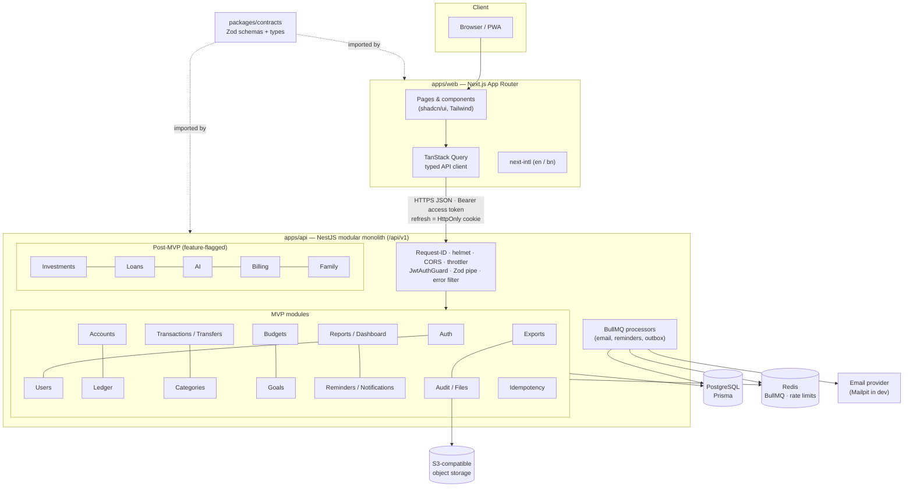
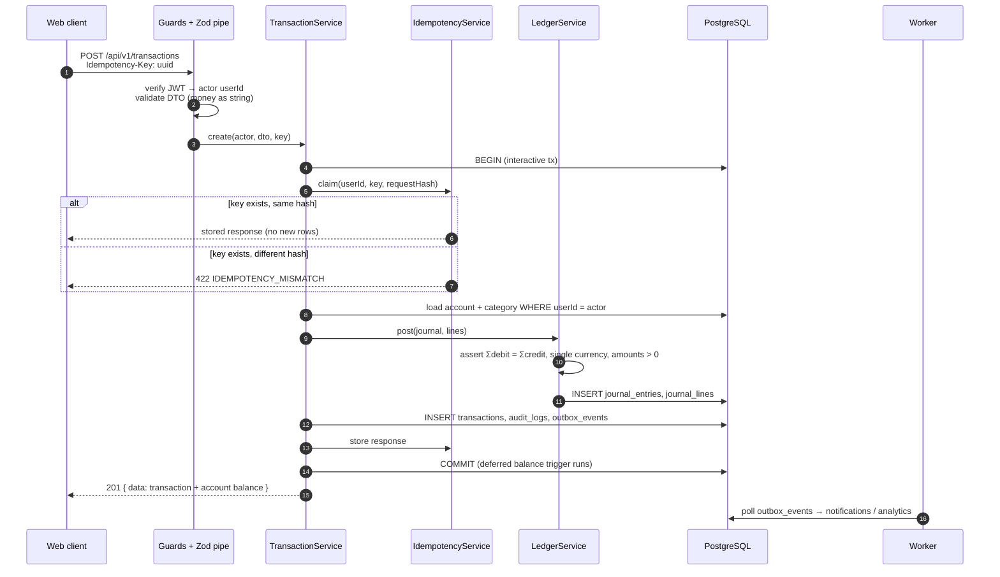
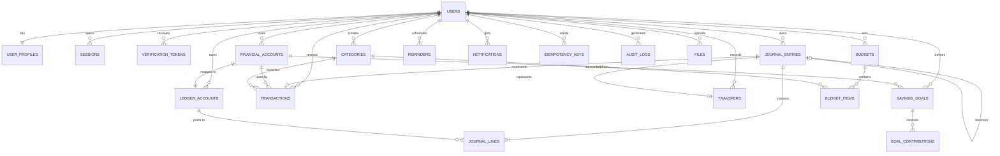

# TakaWise — Architecture & Decision Records

> Phase 0 · 2026-11-05 · Status legend: **Accepted** (default adopted) · **Proposed** (needs owner confirmation)
> See [../implementation-plan.md](../implementation-plan.md) for the phase plan.

---

## Architecture overview

### Posting sequence (income / expense / transfer)

### Core ERD (MVP)

---

## ADR index

| #   | Title                                                                                  | Status   |
| --- | -------------------------------------------------------------------------------------- | -------- |
| 001 | Monorepo with pnpm workspaces, modular monolith                                        | Accepted |
| 002 | Shared Zod contracts package                                                           | Accepted |
| 003 | Money representation: NUMERIC(20,4), Decimal, strings on the wire                      | Accepted |
| 004 | Double-entry ledger is the source of truth; balances are derived                       | Accepted |
| 005 | Balanced-journal invariant enforced in service + deferred DB trigger                   | Accepted |
| 006 | Idempotency via a dedicated table, inside the posting transaction                      | Accepted |
| 007 | Chart of accounts: one ledger account per financial account + per-user system accounts | Accepted |
| 008 | Credit card tracked as a liability                                                     | Accepted |
| 009 | Savings goals use the earmark model                                                    | Accepted |
| 010 | Corrections by reversal; reversal dated to the original effective date                 | Accepted |
| 011 | Auth: short-lived JWT access token + rotating opaque refresh cookie                    | Accepted |
| 012 | Time: UTC timestamps, separate local `effectiveDate`, default Asia/Dhaka               | Accepted |
| 013 | Ownership: actor from session, scoped queries, 404 on foreign resources                | Accepted |
| 014 | Background work: BullMQ inside the API process + transactional outbox                  | Accepted |
| 015 | Testing against real PostgreSQL; Jest (api), Vitest (web), Playwright (e2e)            | Accepted |
| 016 | Single currency per transaction; same-currency transfers only; no FX in MVP            | Accepted |
| 017 | Dev email via Mailpit; console OTP impossible in production                            | Accepted |
| 018 | Toolchain versions: NestJS 11, TypeScript 6, ESLint 9, SWC compilation                 | Accepted |
| 019 | Prisma 7 with pg driver adapter; DB-level invariants and composite ownership FKs       | Accepted |

---

### ADR-001 — Monorepo with pnpm workspaces, modular monolith

**Context:** One small team ships web and API together and shares types between them.
**Decision:** pnpm workspaces (`apps/*`, `packages/*`), with no Turborepo at first. NestJS modules have explicit boundaries: a module exposes a service and never reaches into another module's Prisma models. Ledger writes go only through `LedgerService`.
**Consequences:** Simple tooling. The worker can be split out later without a rewrite. Turbo can be added if CI gets slow.

### ADR-002 — Shared Zod contracts package

**Decision:** `packages/contracts` holds Zod schemas for request DTOs and response shapes, and both apps import them. The API validates with a Zod pipe and generates Swagger from the schemas. Prisma types never leave `apps/api`; responses are mapped explicitly.
**Consequences:** One schema serves form validation and server validation. The browser never sees DB entities (blueprint Phase 2 rule).

### ADR-003 — Money representation

**Decision:** PostgreSQL `NUMERIC(20,4)`, Prisma `Decimal`, and `decimal.js` in domain code. In JSON, money is a **string** (`"450.00"`). Amounts are always positive; direction comes from transaction type and debit/credit. Rounding is half-even to 2 dp **for display only**, and stored values keep 4 dp. ESLint `no-restricted-syntax` bans `parseFloat` and `Number()` on money fields in API domain folders.
**Consequences:** No floating-point drift. The client formats strings with `Intl.NumberFormat` without doing arithmetic on them.

### ADR-004 — Ledger is the source of truth

**Decision:** Account balances, income/expense totals, budgets and reports are all derived from posted `journal_lines` (joined with `transactions` for categories). There is no stored balance column in the MVP. If profiling later shows a need, a projection table may be added, but it must be rebuildable from the ledger, and a `reconcile` command will verify it.
**Normal-balance rules (central, unit-tested):**

| Class     | Normal | Balance formula  |
| --------- | ------ | ---------------- |
| ASSET     | DEBIT  | Σdebit − Σcredit |
| EXPENSE   | DEBIT  | Σdebit − Σcredit |
| LIABILITY | CREDIT | Σcredit − Σdebit |
| EQUITY    | CREDIT | Σcredit − Σdebit |
| INCOME    | CREDIT | Σcredit − Σdebit |

### ADR-005 — Balanced-journal invariant

**Decision:** `LedgerService.post()` asserts ≥ 2 lines, a single currency, each line with exactly one positive side, and Σdebit = Σcredit before inserting. In addition, a raw-SQL migration adds:

- a CHECK on `journal_lines`: `(debit > 0 AND credit = 0) OR (credit > 0 AND debit = 0)`;
- a `CONSTRAINT TRIGGER ... DEFERRABLE INITIALLY DEFERRED` on `journal_lines` that, at commit, raises if any affected journal is unbalanced.

Posted journals and lines are immutable: application code never updates or deletes them, and a trigger blocks UPDATE/DELETE on `journal_lines`.
**Consequences:** A bug in any code path cannot commit an unbalanced or edited history.

### ADR-006 — Idempotency

**Decision:** The `Idempotency-Key` header (UUID) is **required** on `POST /accounts`, `/transactions`, `/transfers`, `/transactions/:id/reverse` and `/goals/:id/contributions`. The `idempotency_keys` row (PK `userId, key`) is inserted **inside the same DB transaction** as the posting, along with a SHA-256 hash of the canonical request. On a replay with the same hash, the stored response is returned. With a different hash, the API returns 422. Concurrent duplicates hit the PK and the loser retries the read. Keys expire after 24 h (a cleanup job removes them).
**Consequences:** Retries after network failures or double-clicks are safe.
**Implementation (Phase 4):** `IdempotencyService.execute()` runs the command inside the same `$transaction` that inserts the key. The request hash is SHA-256 of `scope + canonical JSON`. A replay sets the `Idempotent-Replayed: true` header, and a lost race on the primary key rolls back and returns the winner's stored response. Expired keys (> 24 h) are deleted lazily when the same key is reused. A scheduled cleanup job arrives with BullMQ in Phase 5.

### ADR-007 — Chart of accounts

**Decision:** Every financial account gets exactly one ledger account (1:1). Each user gets system ledger accounts `EQUITY_OPENING_BALANCE`, `INCOME` and `EXPENSE`, created from seeded `ledger_account_templates` at registration. Categories are a dimension on `transactions`, **not** separate ledger accounts.
**Alternatives considered:** a ledger account per category. It gives a richer chart of accounts but makes category edits and archiving complex, and adds nothing for MVP reporting.
**Consequences:** Category breakdown is computed from posted `transactions` that are not reversed. The ledger stays small and simple.

### ADR-008 — Credit card as a liability _(Accepted 2026-11-05)_

**Decision:** `CREDIT_CARD_TRACKING` accounts map to a LIABILITY ledger account (credit-normal). Opening balance is the amount owed (Dr Equity:Opening / Cr Liability). An expense on the card is Dr Expense / Cr Liability. A bill payment is a **transfer** Bank → Card (Dr Liability / Cr Bank), so it is not counted as an expense, which avoids double counting. The UI labels the balance as "Owed". Dashboard "Net balance" = Σ assets − Σ liabilities per currency. Credit limit is optional metadata in the MVP, with no interest or statement logic.
**Confirmed:** credit cards stay in the MVP.

### ADR-009 — Savings goals: earmark model _(Accepted 2026-11-05)_

**Options:** (a) **earmark** against an existing account; (b) actual transfer into a dedicated savings account.
**Decision:** (a) earmark. A goal links to one active asset account in the same currency. `goal_contributions` is append-only, with no ledger journal. Each row has a positive `amount` and a `kind`: `CONTRIBUTION` (set money aside), `WITHDRAWAL` (release money) or `REVERSAL` (corrects one earlier row, with the same amount and once only). Progress = Σ CONTRIBUTION − Σ WITHDRAWAL over rows that are `POSTED` and not reversed. _(Refined in Phase 2: the original wording "a withdrawal is a reversal row" conflated two different user intents.)_ A contribution is rejected if Σ earmarks across that account's goals would exceed its current ledger balance. If the balance later falls below the earmarks, the UI warns ("under-funded"), and no automatic changes are made. Goal amounts cannot be edited directly.
**Why:** No artificial money movement, no extra account the user doesn't actually have, and it fits the common Bangladesh pattern of "this bank balance is for X". Users who actually keep a separate savings account can link the goal to that account, which gives the same result as (b).
**UI copy (required):** "Goal savings are set aside from {account}. No money is moved."

### ADR-010 — Corrections by reversal _(Accepted 2026-11-05)_

**Decision:** Posted transactions and transfers are never edited or deleted. `POST /transactions/:id/reverse` creates a REVERSAL journal with every line swapped, `reversesId` set to the original, and **the same effectiveDate as the original**. The original is marked `REVERSED`, and both remain visible in history. A journal can be reversed only once, and reversal journals cannot themselves be reversed (409). The UI's "Edit" action means reverse and create a replacement, done in one idempotent request (`/transactions/:id/replace`, Phase 4 stretch).
**Non-financial notes:** the free-text `description` of a posted transaction or transfer may be edited, because it changes no amounts, accounts or dates. The database allows only that field and the `POSTED → REVERSED` transition (see [erd.md](erd.md)).
**Why the same date:** For personal finance, the user is fixing a mistake, so the original month's report should change. Budgets and reports exclude both the reversed original and its reversal.
**Alternative:** date the reversal "today" (traditional accounting). Rejected for the MVP because it distorts past-month reports.

### ADR-011 — Authentication & sessions

**Decision:**

- Passwords use Argon2id (`@node-rs/argon2`, OWASP parameters: m=19 MiB, t=2, p=1). Minimum 8 characters, checked against a common-password list.
- The **access token** is a JWT (HS256, 15-minute lifetime, claims `sub`, `sid`). The web client keeps it in memory and sends it as `Authorization: Bearer`.
- The **refresh token** is 256-bit opaque random, stored as a SHA-256 hash in `sessions`, with a 30-day lifetime. It is sent as a cookie `tw_rt` with HttpOnly, Secure (non-dev), `SameSite=Strict` and `Path=/api/v1/auth`. It **rotates on every refresh**. Reusing an already-rotated token revokes the whole `familyId`.
- **CSRF:** Bearer-protected routes are not CSRF-exposed. The cookie routes (`/auth/refresh` and `/auth/logout`) require an `Origin` header in the allowlist **and** an `X-CSRF-Token` matching a non-HttpOnly `tw_csrf` cookie (double-submit).
- Web and API are served **same-site** (e.g. `app.` and `api.` under one domain; `localhost:3100` and `localhost:4000` in dev). CORS uses an explicit allowlist with `credentials: true`.
- Authenticated `/app/*` pages are client-rendered and perform a silent refresh on load, and the marketing pages are static. Edge middleware only redirects when the `tw_csrf` hint cookie is absent, as a UX shortcut that does not provide security.
- A password reset or "log out everywhere" revokes all sessions.

**Implementation notes (Phase 3, 2026-11-05):**

- Every authenticated request also checks that the session row is live and the user is ACTIVE, so revocation takes effect immediately. This costs one indexed primary-key lookup per request.
- Refresh tokens are opaque and stored as SHA-256. `JWT_REFRESH_SECRET` is therefore unused. `AUTH_HMAC_SECRET` (which must differ from `JWT_ACCESS_SECRET`) keys OTP and IP hashes.
- Reuse detection is strict: any second use of a rotated token, including a concurrent double refresh, revokes the family. The web client refreshes single-flight.
- Verification attempts are committed outside the caller's transaction, so a rollback cannot erase a failed guess.
- `verify-email` signs the user in. Registration, resend and forgot-password give identical responses whether or not the account exists.
- Rate limits are in memory, one instance only. Redis storage is planned for Phase 7.
- `@nestjs/jwt` is pinned to 11.x, because 12.x is ESM-only (ADR-018).
- Full reference: [docs/api/auth.md](../api/auth.md).

### ADR-012 — Time handling

**Decision:** All timestamps are `timestamptz` in UTC. Transactions carry `occurredAt` (instant) **and** `effectiveDate` (date), which the server derives using the user's profile timezone (default `Asia/Dhaka`, UTC+6, no DST). Budgets, reports and filters operate on `effectiveDate`. Reminders store `dueAt` in UTC, and the UI converts from and to the user's timezone.

### ADR-013 — Authorization & ownership

**Decision:** The actor always comes from the verified JWT (`@CurrentUser()`), and any `userId` in a body or query is rejected by the schemas. Every repository method on owned tables takes `userId` and includes it in the `WHERE` clause. A resource owned by someone else returns **404** (`NOT_FOUND`). A shared cross-user test suite seeds users A and B and calls every route with A's token against B's IDs. Default deny: every controller is protected unless decorated `@Public()`.

### ADR-014 — Background jobs & outbox

**Decision:** BullMQ queues (`email`, `reminders`, `outbox`, `maintenance`) run inside the API process for the MVP, behind a `WORKER_ENABLED` flag so a separate worker deployment is possible later. Financial commands write `outbox_events` in the same DB transaction, and a poller publishes them to queues. As a result, notifications never fire for rolled-back postings. Redis is never authoritative.

### ADR-015 — Testing strategy

**Decision:** Integration tests run against a real PostgreSQL (`takawise_test`, from Compose locally and a fresh service container in CI). Before the DB suite, Jest global setup runs `prisma migrate deploy` and the idempotent seed. **Nothing is reset or truncated.** Every test creates its own users (random emails), so files run in parallel and never see each other's data. A guard refuses any test database whose name does not end in `_test`. _(Refined in Phase 2: truncating was dropped. Isolated fixtures are safer, and Prisma 7 also blocks agent-run `migrate reset` without explicit human consent.)_ Ledger rules use unit tests plus randomized balanced/unbalanced journal generation. The API uses Jest + Supertest, web and contracts use Vitest, and E2E uses Playwright at desktop and mobile viewports. Coverage gates apply to the `ledger`, `transactions`, `budgets` and `auth` modules.

### ADR-016 — Currency

**Decision:** Every account, journal and transaction stores an ISO-4217 code. The MVP UI offers BDT by default and allows other codes for accounts. Transfers and goal links require matching currencies. Totals are grouped **per currency** and are never summed across currencies. FX is deferred.

### ADR-017 — Development email & OTP safety

**Decision:** Docker Compose runs **Mailpit** (SMTP on host :1035, UI on http://localhost:8035), and dev sends real emails to it. A `DEV_LOG_OTP=true` option prints OTPs to the console. At boot, the env schema **fails** if `DEV_LOG_OTP` is true while `NODE_ENV` is not `development`, and the code path is also guarded at runtime. Production uses an email-provider adapter (provider TBD).

---

## Out of scope for MVP (recorded)

- Bank, bKash, Nagad, Rocket or card integrations, scraping, and collection of credentials, PINs, OTPs or CVVs.
- Payment initiation, custody, lending, investment execution.
- AI advice, OCR and recurring transactions (v1.1+), family workspaces, billing, admin console.
- Native mobile apps (the web app is responsive and PWA-ready).

### ADR-018 — Toolchain versions (Phase 1, 2026-11-05)

**Context:** At Phase 1 time the latest majors were NestJS 12 (ESM-only, released 2026-08), TypeScript 7 (native compiler) and ESLint 10.
**Decision:**

- **NestJS 11.2.x (CommonJS)**, not 12. Nest 12 is ESM-only and recent, and `nestjs-zod` supports only Nest ≤ 11. CommonJS keeps Jest, Prisma and the tooling simple. Revisit after the MVP.
- **TypeScript ~6.0**, not 7. `typescript-eslint` (< 6.1), `ts-jest` and `@nestjs/swagger` do not support TS 7 yet.
- **ESLint 9.39**, not 10. `eslint-plugin-react`, `-import` and `-jsx-a11y` (used by `eslint-config-next`) do not support ESLint 10 yet.
- **SWC compiles the API** in dev (`nest start --watch`), build (`nest build`) and tests (`@swc/jest`). TypeScript 6 is used only for `typecheck`. This avoids Nest CLI's bundled TS 5.9 and ts-jest's limits with `nodenext`.
- The API is tested with **Jest + Supertest**. Web and contracts are tested with **Vitest**.
- pnpm 10 dependency build scripts are allow-listed (`@swc/core`, `@parcel/watcher`), and analytics postinstalls (`@scarf/scarf`) are denied.

**Consequences:** All pins are exact in the package manifests and the lockfile. Upgrading any of the three majors is a deliberate, separately tested change.

### ADR-019 — Prisma 7 and database-level invariants (Phase 2, 2026-11-05)

**Context:** npm's `latest` tag for `prisma` pointed at a release candidate (8.0.0-rc) at Phase 2 time. Prisma 7 is ESM-first, needs a driver adapter, and moves connection URLs out of `schema.prisma`.
**Decision:**

- **Prisma 7.10.1** (the last stable release), pinned exactly, with `@prisma/adapter-pg`. The `prisma-client` generator emits a **CommonJS** client into `apps/api/src/generated/prisma`. The client is git-ignored and regenerated by the API's `postinstall`.
- The connection URL lives in `apps/api/prisma.config.ts` (which loads `apps/api/.env` locally). The API builds clients through `createPrismaClient()` and `PrismaService`, which connect lazily so `/health` stays up while `/health/ready` reports the database as down.
- **Defence in depth:** every financial rule is enforced in SQL as well as in services. This covers CHECKs, a deferred balanced-journal constraint trigger, immutability triggers, category and currency consistency triggers, and partial unique indexes. Ownership is also enforced in SQL through **composite foreign keys** `(child.x_id, child.user_id) → parent(id, user_id)`. A bug that forgets a `userId` filter therefore cannot link two users' records. See [erd.md](erd.md) for the full catalogue.
- Prisma does not model these SQL objects, so they live in a hand-written migration. CI proves there is no drift with `prisma migrate diff --exit-code`.
- `prisma init` is not used inside the repo, because it adds agent-tooling folders. Destructive Prisma commands (`migrate reset`) are only ever run by a human.

**Consequences:** Upgrading Prisma (including to 8.x) is a deliberate, separately tested change. Raw SQL objects must be kept in step with schema changes. The DB suite catches any divergence.
