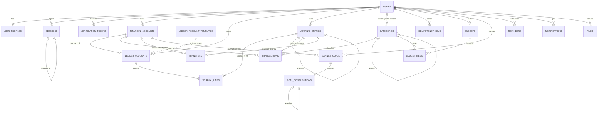

# TakaWise — Database ERD and Constraint Catalogue

> Phase 2 · 2026-11-05 · Source: [apps/api/prisma/schema.prisma](../../apps/api/prisma/schema.prisma) and
> [migrations](../../apps/api/prisma/migrations). The schema file is authoritative. This page explains it.

## Conventions

| Topic          | Rule                                                                                                                                                      |
| -------------- | --------------------------------------------------------------------------------------------------------------------------------------------------------- |
| Keys           | UUIDv7 (`uuid(7)`, time-ordered), generated by Prisma                                                                                                     |
| Naming         | `snake_case` tables and columns, mapped to camelCase in TypeScript                                                                                        |
| Money          | `NUMERIC(20,4)` + explicit `CHAR(3)` ISO-4217 currency. Amounts are positive, and direction comes from type or debit/credit                               |
| Time           | `timestamptz(3)` in UTC. Financial effective dates use `DATE`                                                                                             |
| Deletes        | Anything referencing postings is `ON DELETE RESTRICT`. Auth-only data (profile, sessions, tokens, notifications, idempotency keys) cascades with the user |
| Cross-user FKs | Owned children reference parents by `(id, user_id)`, so the database itself rejects mixing two users' rows                                                |

## ERD



`audit_logs` and `outbox_events` deliberately have **no foreign keys**: the audit trail must survive account deletion or anonymisation, and outbox rows may outlive their subject.

## Tables

| Table                      | Purpose                                                                           | Notable constraints                                                                                             |
| -------------------------- | --------------------------------------------------------------------------------- | --------------------------------------------------------------------------------------------------------------- |
| `users`                    | Login identity                                                                    | email unique **and** lower-cased (`users_email_normalized`)                                                     |
| `user_profiles`            | Name, locale (EN/BN), timezone (default `Asia/Dhaka`), default currency (`BDT`)   | ISO currency                                                                                                    |
| `sessions`                 | Refresh-token sessions (hash only), `family_id` for reuse detection               | token hash unique                                                                                               |
| `verification_tokens`      | Email-verify / reset codes (HMAC only), attempts, expiry                          | attempts ≥ 0                                                                                                    |
| `financial_accounts`       | User-facing accounts. No balance column (ADR-004)                                 | opening balance ≥ 0. Credit limit only on cards. Active names unique per user, case-insensitive                 |
| `ledger_account_templates` | Seeded system codes: `EQUITY_OPENING_BALANCE`, `INCOME`, `EXPENSE`                | class ↔ normal balance                                                                                          |
| `ledger_accounts`          | Chart of accounts: one per financial account plus three per-user system accounts  | exactly one of `financial_account_id` / `system_code`. Class ↔ normal balance. Card → LIABILITY, others → ASSET |
| `journal_entries`          | Posted journals (immutable)                                                       | REVERSAL ⇔ `reverses_id`. One reversal per entry. No reversal of a reversal                                     |
| `journal_lines`            | Debit/credit lines (immutable)                                                    | exactly one side > 0. **Deferred balance trigger**                                                              |
| `transactions`             | Income/expense command record ↔ its journal                                       | amount > 0. Category usable and type-matched. Journal kind and currency match. Financial fields frozen          |
| `transfers`                | Same-currency transfer ↔ its journal                                              | distinct accounts. Same currency everywhere. Financial fields frozen                                            |
| `idempotency_keys`         | Replay protection (ADR-006)                                                       | PK `(user_id, key)`                                                                                             |
| `categories`               | System (`user_id` null, stable `system_key`) and custom categories, EN + BN names | parent same type and owner. Active custom names unique per user and type                                        |
| `budgets`, `budget_items`  | Period budgets with optional overall limit plus per-category limits               | end ≥ start. Amounts > 0. Items use expense categories only                                                     |
| `savings_goals`            | Earmark goals linked to one asset account (ADR-009)                               | not a card account. Currency matches the account                                                                |
| `goal_contributions`       | Append-only `CONTRIBUTION` / `WITHDRAWAL` / `REVERSAL` rows                       | reversal: same goal, same amount, only once. Rows are never edited                                              |
| `reminders`                | One-time reminders (`due_at` UTC + entry timezone)                                | title not blank                                                                                                 |
| `notifications`            | In-app notifications                                                              | —                                                                                                               |
| `outbox_events`            | Transactional outbox (ADR-014)                                                    | attempts ≥ 0                                                                                                    |
| `files`                    | Object-storage metadata                                                           | size > 0                                                                                                        |
| `audit_logs`               | Append-only audit trail                                                           | UPDATE/DELETE blocked                                                                                           |

## Invariants enforced by the database

All of these live in `20261105152200_ledger_constraints/migration.sql`. The application checks the same rules first so it can return friendly errors. The database is the last line of defence.

| Invariant                                                                                                                                                           | Mechanism                                                                                                                                                  | Error                                                                                                                                              |
| ------------------------------------------------------------------------------------------------------------------------------------------------------------------- | ---------------------------------------------------------------------------------------------------------------------------------------------------------- | -------------------------------------------------------------------------------------------------------------------------------------------------- |
| Σdebit = Σcredit, ≥ 2 lines, single currency, same owner                                                                                                            | `CONSTRAINT TRIGGER … DEFERRABLE INITIALLY DEFERRED` on `journal_lines` **and** `journal_entries` (so entries with zero lines fail too), checked at COMMIT | `23514` + constraint `journal_entries_balanced` / `_min_two_lines` / `journal_lines_currency_matches_entry` / `journal_lines_ledger_account_owner` |
| A line is one-sided and positive                                                                                                                                    | CHECK `journal_lines_one_sided_positive`                                                                                                                   | `23514`                                                                                                                                            |
| Journals and lines are never changed                                                                                                                                | `BEFORE UPDATE OR DELETE` triggers                                                                                                                         | `55000`                                                                                                                                            |
| Transactions and transfers keep their financial fields. Only `POSTED → REVERSED` (with the matching REVERSAL journal) and description edits are allowed. No deletes | `tw_trg_posting_update_guard`                                                                                                                              | `55000` / `23514`                                                                                                                                  |
| Goal contributions are append-only (only `POSTED → REVERSED`)                                                                                                       | `tw_trg_goal_contribution_guard`                                                                                                                           | `55000`                                                                                                                                            |
| Audit log is append-only                                                                                                                                            | trigger                                                                                                                                                    | `55000`                                                                                                                                            |
| No cross-user references                                                                                                                                            | composite FKs `(x_id, user_id)` plus owner checks for categories and ledger lines                                                                          | `23503` / `23514`                                                                                                                                  |
| Category type matches its use                                                                                                                                       | `tw_assert_category_usable`                                                                                                                                | `23514`                                                                                                                                            |

### Added in Phase 5 (`20261105170000_planning_rules`)

| Invariant                                                   | Mechanism                                                      |
| ----------------------------------------------------------- | -------------------------------------------------------------- |
| One active budget per user, month and currency              | partial unique index `budgets_user_period_currency_active_key` |
| Categories at most two levels deep                          | `tw_trg_categories_parent` (redefined)                         |
| ACHIEVED goals have `achieved_at`; ARCHIVED ⇔ `archived_at` | CHECKs on `savings_goals`                                      |
| DONE reminders ⇔ `completed_at`                             | CHECK on `reminders`                                           |
| Fast scan of due, un-notified reminders                     | partial index `reminders_due_unnotified_idx`                   |

### Application-only rules (not enforced in SQL)

- Archived accounts and categories cannot receive **new** postings. History may still reference them.
- An earmark cap: total goal contributions ≤ the linked account's ledger balance (ADR-009). This depends on live balances, so it is enforced in the service.
- A transaction's amount equals its journal's amount. The posting service builds both from the same value.
- Idempotency semantics (same hash → stored response; different hash → 422).

## Migrations workflow

```bash
pnpm db:migrate            # dev: create + apply a migration from schema.prisma changes
pnpm --filter @takawise/api db:migrate:create --name <name>   # create only (to add raw SQL)
pnpm db:deploy             # apply pending migrations (CI / staging / production)
pnpm db:seed               # idempotent reference data (categories, ledger templates)
pnpm db:status
```

- Never edit an applied migration. Add a new one.
- Raw SQL (CHECKs, triggers, partial indexes) goes in a `--create-only` migration. CI runs `prisma migrate diff --exit-code` to prove `schema.prisma` and the migrations agree.
- `pnpm db:reset` **drops all data** in the target database. It is for local development only, and Prisma requires explicit human confirmation.
